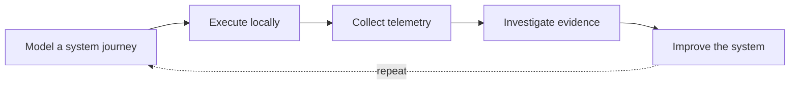

<!--
  Hunter Macias — GitHub profile
  All illustrations and animations are self-hosted in ./assets.
  No external image servers, tracking pixels, fonts, or third-party stat cards.
  Customize with docs/CUSTOMIZE.md.
-->

<picture>
  <source media="(prefers-color-scheme: dark)" srcset="https://raw.githubusercontent.com/huntermacias/huntermacias/main/assets/hero-dark.svg" />
  <source media="(prefers-color-scheme: light)" srcset="https://raw.githubusercontent.com/huntermacias/huntermacias/main/assets/hero-light.svg" />
  
</picture>

  <strong>Software engineer & product builder</strong> · Quality engineering at <strong>Costco Travel</strong> · Building <strong>Spikeproof</strong> independently
   
  I care about software that is reliable underneath and exceptional to use.

  <a href="https://spikeproof.dev">Spikeproof</a> &nbsp;·&nbsp;
  <a href="https://huntermacias.com">Website</a> &nbsp;·&nbsp;
  <a href="https://github.com/huntermacias?tab=repositories">Code</a> &nbsp;·&nbsp;
  <a href="https://www.raidersrundown.com">Writing</a> &nbsp;·&nbsp;
  <a href="https://x.com/HunterMacias_">X</a>

---

### A little about me

I got into programming because I loved the idea that a sketch of a system could become something real. That curiosity turned into a career spanning software development, API quality, test infrastructure, and performance engineering.

Today, I work on software quality and performance at **Costco Travel**. Outside work, I build developer tools and products of my own. I care as much about the interaction model and the last 10% of polish as I do about the architecture behind it.

**My north star:** make powerful systems easier for people to understand and operate.

### Featured build — Spikeproof

<a href="https://spikeproof.dev">
  <picture>
    <source media="(prefers-color-scheme: dark)" srcset="https://raw.githubusercontent.com/huntermacias/huntermacias/main/assets/spikeproof-dark.svg" />
    <source media="(prefers-color-scheme: light)" srcset="https://raw.githubusercontent.com/huntermacias/huntermacias/main/assets/spikeproof-light.svg" />
    
  </picture>
</a>

**[Spikeproof](https://spikeproof.dev)** is an independently developed desktop performance engineering workspace. It brings API testing, browser flows, conditional journeys, k6 load execution, and detailed investigation into one place.

Instead of stopping at *“the p95 went up,”* I'm exploring what it looks like for a tool to help answer *“what actually changed in the system, and why?”*

| Design journeys | Apply real load | Follow the evidence |
| :--- | :--- | :--- |
| API + browser flows, branching, and shared test data | Locally executed k6 workloads, thresholds, and reusable tests | Latency distributions, errors, step-level analysis, and run comparisons |

**[Explore the product](https://spikeproof.dev)** · **[Desktop releases](https://github.com/huntermacias/spikeproof-releases)** · **[Report an issue](https://github.com/huntermacias/spikeproof-releases/issues)**

Spikeproof is an independent project. Its application source is currently private; the public releases repository distributes installers.

<strong>Under the hood · The engineering problems I'm exploring</strong>

 

- **Execution that tells the truth.** Real runs have partial output, dropped iterations, failed assertions, retries, timeouts, and early termination. The report needs to distinguish all of them.
- **Useful observability.** Distribution-aware latency telemetry, synchronized time windows, step-level evidence, and comparisons that account for different request mixes.
- **Journeys as systems.** Parallel operations, conditional branches, variables, browser actions, and API requests belong in one coherent testing model.
- **Thoughtful developer experience.** Powerful tools should be navigable by people who didn't build them.

### What I've been building publicly

<picture>
  <source media="(prefers-color-scheme: dark)" srcset="https://raw.githubusercontent.com/huntermacias/huntermacias/main/assets/activity-dark.svg" />
  <source media="(prefers-color-scheme: light)" srcset="https://raw.githubusercontent.com/huntermacias/huntermacias/main/assets/activity-light.svg" />
  
</picture>

This is a **public-project signal**, not an activity score. The image refreshes from GitHub's public repository API when the included workflow is enabled; private work is never included.

Some public repositories worth exploring: **[Spikeproof releases](https://github.com/huntermacias/spikeproof-releases)** · **[Similarity-Scout](https://github.com/huntermacias/Similarity-Scout)** · **[hunter.me](https://github.com/huntermacias/hunter.me)**. These are different kinds of work, and not all represent my current technical approach.

### The work I gravitate toward

| Area | What interests me |
| :--- | :--- |
| **Developer experience** | Building tools that make complicated workflows feel intuitive. |
| **Performance & reliability** | Understanding bottlenecks, failure paths, and system behavior under stress. |
| **Full-stack product engineering** | Taking an idea from interface and architecture to something people can actually use. |
| **Teaching & leadership** | Explaining difficult concepts clearly and helping engineers become more effective. |

<strong>Engineering notebook · Principles I try to build by</strong>

 

**Start with the evidence.** A beautiful dashboard isn't useful if the underlying measurements are misleading.

**Make failure states first-class.** Slow requests, skipped operations, incomplete runs, and invalid assumptions should never quietly masquerade as success.

**Optimize for understanding.** The right visualization can replace ten paragraphs. The wrong one can obscure a system's most important behavior.

**Sweat the interaction details.** Keyboard navigation, empty states, compact layouts, readable information density, and a predictable workflow matter.

**Keep an open mind.** Some of the best engineering ideas come from the people closest to the problem, regardless of title.

<strong>Toolbox · Languages, frameworks and engineering systems</strong>

 

| | Tools I use |
| :--- | :--- |
| **Languages** | TypeScript, JavaScript, Python, Java, SQL |
| **Frontend** | React, Next.js, Tailwind CSS |
| **Backend & APIs** | Node.js, Spring Boot, REST APIs |
| **Testing & performance** | k6, Playwright, Selenium, JUnit, Pact, REST Assured |
| **Delivery & diagnostics** | GitHub Actions, Jenkins, Azure DevOps, Splunk Observability |

Tools change. My preference for reliable systems and clear interfaces doesn't.

### Beyond the editor

I’ve taught programming and worked with students learning to write their first real software. I also build and write **[Raiders Rundown](https://www.raidersrundown.com)**, an independent football publication—another excuse to combine engineering, storytelling, and a strong point of view.

If you're interested in developer tools, performance engineering, or building ambitious products, you'll find common ground here.

  <a href="https://spikeproof.dev"><strong>See what I'm building</strong></a>
  &nbsp;·&nbsp;
  <a href="https://github.com/huntermacias?tab=repositories"><strong>Browse projects</strong></a>
  &nbsp;·&nbsp;
  <a href="https://huntermacias.com"><strong>Visit my site</strong></a>

<picture>
  <source media="(prefers-color-scheme: dark)" srcset="https://raw.githubusercontent.com/huntermacias/huntermacias/main/assets/footer-dark.svg" />
  <source media="(prefers-color-scheme: light)" srcset="https://raw.githubusercontent.com/huntermacias/huntermacias/main/assets/footer-light.svg" />
  
</picture>

Designed and maintained by Hunter. Original SVG artwork lives in this repository, supports dark and light themes, and respects reduced-motion preferences.
